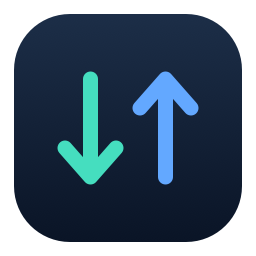
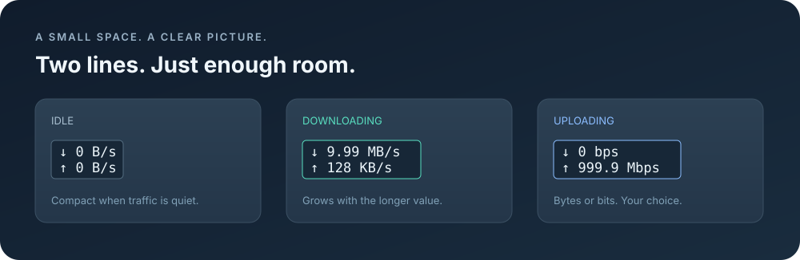

<div align="center">



# NetSpeed

**Live network speed. Right in your menu bar.**

A compact, native macOS utility for real-time download and upload speeds.

**English** · [简体中文](README.zh-CN.md)

[](https://github.com/isJDongYa/NetSpeed/actions/workflows/ci.yml)
[](https://github.com/isJDongYa/NetSpeed/releases/latest)
[](LICENSE)
[](#requirements)
[](#build-from-source)
[](#features)

**[Download for macOS](https://github.com/isJDongYa/NetSpeed/releases/latest/download/NetSpeed-macOS-universal.zip)** · [Release notes](https://github.com/isJDongYa/NetSpeed/releases)



<sub>Layout illustration with sample speeds. Width follows the longer line.</sub>

</div>

## Features

- **Two lines, one glance.** Download (`↓`) and upload (`↑`) speeds, updated every second.
- **Fits the text.** The menu bar item grows and shrinks with the longer line, with a small margin on each side.
- **Follows your connection.** Automatic selection of the system's primary IPv4 or IPv6 interface, plus manual interface selection.
- **No duplicate VPN totals.** Measures one interface at a time instead of adding a tunnel and its underlying physical connection together.
- **Your preferred units.** Switch between bytes per second (`KB/s`, `MB/s`) and bits per second (`Mbps`).
- **Launch at login.** Optional, controlled through the app menu or macOS Login Items.
- **Local and private.** Reads interface byte counters. No analytics, browsing history collection, accounts, or outgoing network requests.
- **Native and small.** Swift + AppKit, with no third-party dependencies and no Dock icon.

The app currently uses **Simplified Chinese menus**. The speed display uses arrows, numbers, and standard units.

## Requirements

- macOS **13 Ventura or later**.
- Apple Silicon or Intel Mac; build for the appropriate architecture.
- To build: Xcode or Apple's Command Line Tools with a **Swift 6** toolchain.

Local runtime validation was performed on Apple Silicon with macOS 27.0.1. CI builds and runs the included checks on both architectures; this does not replace interactive testing on every supported macOS release.

## Download and install

1. Download **[NetSpeed-macOS-universal.zip](https://github.com/isJDongYa/NetSpeed/releases/latest/download/NetSpeed-macOS-universal.zip)** from the [latest release](https://github.com/isJDongYa/NetSpeed/releases/latest).
2. Unzip it and move **NetSpeed.app** to `~/Applications` or `/Applications`.
3. Open the app. The same bundle includes **Apple Silicon and Intel** executables.

Release binaries are **built and checked on GitHub Actions**, then attached automatically to the release. They are **ad-hoc signed, not notarized**. macOS may require approval in **System Settings → Privacy & Security** before the first launch. The release includes `SHA256SUMS.txt` for download integrity checks.

## Build from source

```sh
git clone https://github.com/isJDongYa/NetSpeed.git
cd NetSpeed
zsh scripts/build.sh
open delivery/NetSpeed.app
```

The script builds for the current Mac's architecture. To select a target explicitly:

```sh
zsh scripts/build.sh arm64
# Or, for Intel:
zsh scripts/build.sh x86_64
# Or a single app containing both architectures:
zsh scripts/build.sh universal
```

The output is `delivery/NetSpeed.app`. Move it to `~/Applications` or `/Applications` before enabling launch at login, and keep it there afterwards.

CI also produces ZIP bundles under the successful run's **Artifacts** section. Those are development builds; use [Releases](https://github.com/isJDongYa/NetSpeed/releases) for versioned downloads. Both use ad-hoc signing rather than a Developer ID certificate.

## Use

1. Open **NetSpeed.app**. The two-line speed display appears in the menu bar.
2. Click it to choose a network interface, change units, enable launch at login, or quit.
3. Hold **Command** and drag the item to adjust its menu bar position.

| Menu label | Meaning |
| --- | --- |
| 网络接口 | Network interface; automatic or manual |
| 速度单位 | Speed units; bytes or bits per second |
| 登录时启动 | Launch at login |
| 关于 NetSpeed | About NetSpeed |
| 退出 NetSpeed | Quit NetSpeed |

Launch at login is off by default for new installations. You can also add the app in **System Settings → General → Login Items**.

### Reading the numbers

NetSpeed shows **current traffic**, not a speed test, your broadband plan's maximum, or the Wi-Fi link rate.

Units use decimal prefixes: `1 KB = 1,000 B`, `1 MB = 1,000,000 B`, and `1 B = 8 bits`. Startup, interface changes, counter resets, and wake from sleep begin with a fresh baseline. A brief `—` during that first sample is expected.

### Nothing in the menu bar?

On macOS 26 and later, check **System Settings → Menu Bar** and allow **NetSpeed** to appear. A manually selected interface that disconnects is reported as unavailable; choose automatic mode or another interface from the menu.

## Development and checks

```sh
zsh scripts/build.sh
delivery/NetSpeed.app/Contents/MacOS/NetSpeed --self-test
delivery/NetSpeed.app/Contents/MacOS/NetSpeed --sample 5
```

The self-checks cover 64-bit counters, elapsed time, interface switching and recreation, disconnection, counter resets, delayed samples, unit conversion, malformed system data, and adaptive display width. `--sample` prints real local interface measurements without opening the GUI.

| Path | Purpose |
| --- | --- |
| `Sources/NetworkMonitor.swift` | Interface counters, rate calculation, units, and core checks |
| `Sources/App.swift` | Menu bar display, menus, login controls, and layout checks |
| `Sources/main.swift` | Application and diagnostic entry points |
| `scripts/build.sh` | Build and locally sign the macOS app |
| `scripts/make-icon.swift` | Generate the app icon with AppKit |
| `.github/workflows/ci.yml` | Build, check, and package Apple Silicon, Intel, and universal apps |
| `.github/workflows/release.yml` | Build tagged source on GitHub and publish release assets with checksums |
| `VERSION` | Version shared by the app bundle and release checks |

### Publishing a version

Update `VERSION`, add `docs/releases/vX.Y.Z.md`, and publish a GitHub Release with the matching `vX.Y.Z` tag. The Release workflow builds Apple Silicon, Intel, and universal variants on GitHub-hosted Macs. After every build and check passes, it attaches the cloud-built universal app, a checksum file, and a link to the build run. Release binaries are not uploaded from a developer's machine.

Bug reports and pull requests are welcome. Please include your macOS version, Mac architecture, build steps, and what you expected to see. See [CONTRIBUTING.md](CONTRIBUTING.md).

## License

[MIT](LICENSE) © 2026 isJDongYa.
