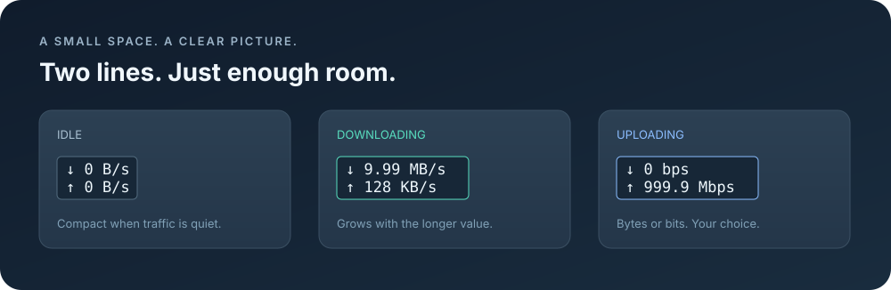

<div align="center">


# NetSpeed

**实时网速，抬眼即见。**

一个轻巧的原生 macOS 菜单栏工具，实时显示下载和上传速度。

[English](README.md) · **简体中文**

[](https://github.com/isJDongYa/NetSpeed/actions/workflows/ci.yml)
[](LICENSE)
[](#系统要求)
[](#从源码构建)
[](#功能)



<sub>使用示例数值绘制的布局示意图；宽度以较长的一行为准。</sub>

</div>

## 功能

- **上下行同时显示**：`↓` 下载、`↑` 上传，每秒更新。
- **宽度自动适配**：按两行文字中较长的一行自动伸缩，两侧仅保留少量边距。
- **跟随当前连接**：自动选择系统当前的 IPv4 或 IPv6 主接口，也可手动选择网卡。
- **避免 VPN 重复计数**：一次测量一个接口，不将隧道和底层物理网卡的同一份流量重复相加。
- **可切换速度单位**：支持字节/秒（`KB/s`、`MB/s`）和比特/秒（`Mbps`）。
- **可选登录启动**：通过应用菜单或 macOS 登录项设置控制。
- **本地运行**：只读取网卡字节计数，不收集浏览记录、没有统计追踪、无需账户，也不向外发送网络请求。
- **原生轻量**：使用 Swift 和 AppKit，无第三方依赖，不占用程序坞位置。

当前应用菜单使用**简体中文**，菜单栏中的速度使用箭头、数字和标准单位显示。

## 系统要求

- macOS **13 Ventura 或更高版本**。
- Apple Silicon 或 Intel Mac，按对应架构构建。
- 构建需要 Xcode 或 Apple Command Line Tools，以及 **Swift 6** 工具链。

本机实际运行验证使用 Apple Silicon 和 macOS 27.0.1。CI 会在两种架构上构建并运行内置检查，但这不代表已完成所有支持系统版本的人工交互验证。

## 从源码构建

```sh
git clone https://github.com/isJDongYa/NetSpeed.git
cd NetSpeed
zsh scripts/build.sh
open delivery/NetSpeed.app
```

默认构建当前 Mac 的架构，也可明确指定目标：

```sh
zsh scripts/build.sh arm64
# Intel 版本：
zsh scripts/build.sh x86_64
```

应用输出到 `delivery/NetSpeed.app`。启用登录启动前，请将它移到 `~/Applications` 或 `/Applications`，之后保持该位置。

构建使用**本地临时签名**，**未经过开发者公证**。CI 成功运行后，其 **Artifacts** 区域也会提供对应架构的 ZIP 包。这些是开发构建，并非 Developer ID 签名的正式发行包。

## 使用

1. 打开 **NetSpeed.app**，菜单栏会出现两行速度。
2. 点击速度，可选择网络接口、切换单位、启用登录启动或退出。
3. 按住 **Command** 拖动项目，可调整菜单栏中的位置。

新安装时，登录启动默认关闭。也可在**系统设置 → 通用 → 登录项**中添加应用。

### 如何理解速度

NetSpeed 显示的是**当前实际传输速率**，不是网络测速结果、宽带套餐上限或 Wi-Fi 连接速率。

单位采用十进制：`1 KB = 1,000 B`、`1 MB = 1,000,000 B`、`1 B = 8 bit`。启动、切换接口、计数重置和休眠恢复时会重新建立采样基线，第一秒短暂显示 `—` 属于正常现象。

### 菜单栏没有显示？

macOS 26 及更新系统可在**系统设置 → 菜单栏**中允许 **NetSpeed** 显示。手动选择的接口断开后，应用会提示该接口不可用；可从菜单切回自动模式或选择其他接口。

## 开发与验证

```sh
zsh scripts/build.sh
delivery/NetSpeed.app/Contents/MacOS/NetSpeed --self-test
delivery/NetSpeed.app/Contents/MacOS/NetSpeed --sample 5
```

内置检查覆盖 64 位计数、实际采样间隔、网卡切换与重建、断线、计数重置、长时间暂停、单位换算、系统数据解析和菜单栏宽度适配。`--sample` 会输出本机实际接口的采样结果，不打开界面。

| 路径 | 用途 |
| --- | --- |
| `Sources/NetworkMonitor.swift` | 网卡计数、速度计算、单位和核心检查 |
| `Sources/App.swift` | 菜单栏绘制、菜单、登录启动和布局检查 |
| `Sources/main.swift` | 应用与诊断命令入口 |
| `scripts/build.sh` | 构建和本地签名 |
| `scripts/make-icon.swift` | 使用 AppKit 生成应用图标 |
| `.github/workflows/ci.yml` | 两种架构的构建、检查和打包 |

欢迎提交 Issue 或 Pull Request。报告问题时请附上 macOS 版本、Mac 架构、构建步骤、预期结果及实际现象。贡献说明见 [CONTRIBUTING.md](CONTRIBUTING.md)。

## 许可证

[MIT](LICENSE) © 2026 isJDongYa。
